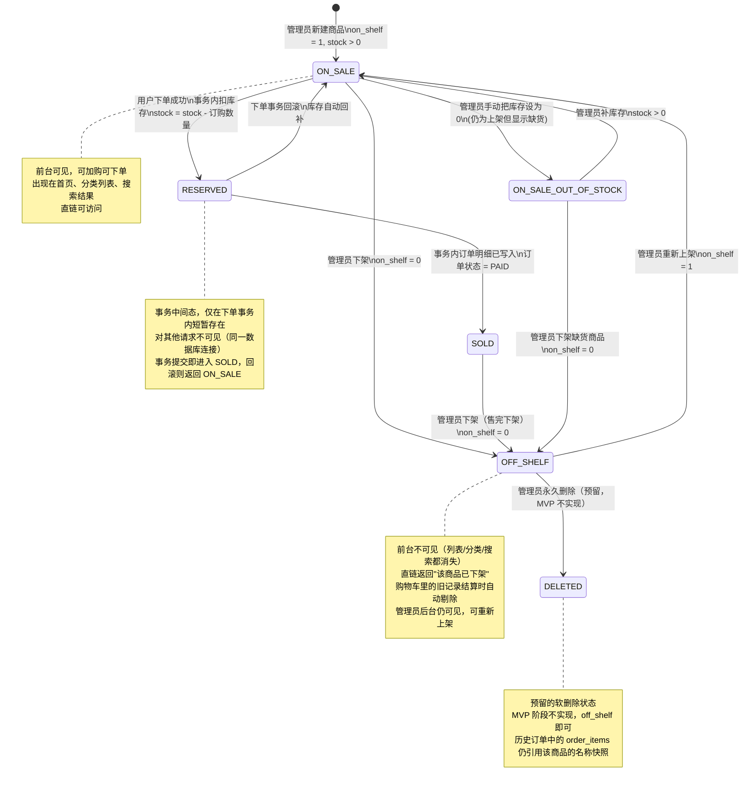

# 文具商城 MVP · 产品需求规格说明书（PRD）

> 版本：v1.0 · 日期：2026-10-29
> 技术栈：Vue 3 + Vite + Axios 前端 · Java 17 + Spring Boot 3 + MyBatis 后端 · MySQL 8
> 依赖文档：[USER_STORIES.md](./USER_STORIES.md)（用户故事 + BDD 验收）
> 依据：平时作业《商城系统》需求文档

---

## 1. 系统概述与 MVP 业务边界

### 1.1 系统定位

文具商城是一套面向真实用户的 **B2C 单店商城系统**，服务一家实体文具店的线上零售需求。前台面向消费者（游客 / 普通用户），后台面向店主（管理员），**前后端共用同一后端与同一数据库**。系统所有商品、订单、评价数据均落在 MySQL 数据库，而非前端写死。

### 1.2 MVP 核心闭环（一条主链路必须跑通）

```
游客打开首页（看分类 + 推荐商品）
  → 注册 / 登录
  → 浏览二级分类下的商品 → 加入购物车
  → 勾选购物车行 → 结算（填一个地址文本框）→ 模拟付款
  → 订单状态 = 已支付
  → 管理员后台标记发货 → 订单状态 = 已发货
  → 用户确认收货 → 订单状态 = 已完成
  → 用户对已完成订单的商品写评价
  → 下架商品在前台彻底消失、无法购买
```

### 1.3 系统边界（必须覆盖）

| 维度 | 边界 |
|------|------|
| 角色 | 3 类：游客 / 普通用户 / 管理员；注册只产生普通用户；管理员禁止下单 |
| 商品分类 | 两级分类（一级 ≥ 3，商品挂二级）；下架商品不出现在前台任何列表 |
| 订单状态 | **5 个固定状态**：UNPAID / PAID / SHIPPED / COMPLETED / CANCELLED |
| 事务 | 扣库存 + 写订单 + 写订单明细在**一个事务**中，任一失败全部回滚 |
| 价格快照 | order_items 存**下单当时**的商品名称和单价，后续改价不影响历史 |
| 模拟付款 | 点按钮直接把状态从 UNPAID → PAID，**不接真实支付** |
| 越权防护 | 普通用户访问后台接口、访问他人订单号 → **后端拒绝**（非仅前端隐藏） |
| 密码存储 | 后端必须做哈希 + 盐，**数据库中绝不明文** |
| 终态锁定 | COMPLETED 和 CANCELLED 是终态，任何角色不能再改 |

---

## 2. 角色与 RBAC 权限矩阵

### 2.1 角色定义

| 角色 | 英文代码 | 来源 | 说明 |
|------|----------|------|------|
| 游客 | `VISITOR` | 未登录 | 浏览级权限 |
| 普通用户 | `NORMAL_USER` | 注册生成 | 交易主体 |
| 管理员 | `ADMIN` | DB 初始化脚本预置（固定 1 个） | 后台运营，禁止下单 |

### 2.2 权限矩阵表（✓ 允许 / ✗ 禁止 / ⚠ 条件允许）

| 功能域 | 操作 | Visitor | NormalUser | Admin |
|--------|------|:-------:|:----------:|:-----:|
| **身份** | 注册（产生 NORMAL_USER） | ✓ | ✗ | ✗ |
| | 登录（返回 token / session） | ✓ | ✓ | ✓ |
| | 登出（后端使 token 失效） | ✗ | ✓ | ✓ |
| | 刷新页面保持登录态 | ✗ | ✓ | ✓ |
| **前台浏览** | 浏览首页（站名/导航/一级分类/推荐商品） | ✓ | ✓ | ✗* |
| | 浏览二级分类商品列表 | ✓ | ✓ | ✗* |
| | 查看商品详情（含评价列表） | ✓ | ✓ | ✗* |
| | 搜索 / 按一级分类筛选 | ✓ | ✓ | ✗* |
| **购物车** | 加入购物车（后端校验上架 + 库存） | ✗ | ✓ | ✗ |
| | 修改数量 / 删除 / 清空 | ✗ | ✓ | ✗ |
| | 查看购物车合计 | ✗ | ✓ | ✗ |
| | 结算前自动剔除下架商品 | — | ✓ | — |
| **下单** | 勾选购物车行生成订单 | ✗ | ✓ | ✗ |
| | 填收货地址文本框 | — | ✓ | — |
| | 模拟付款（UNPAID → PAID） | — | ✓ | — |
| **前台订单** | 查看自己的订单列表 + 详情 | ✗ | ✓ | ✗ |
| | 取消订单（仅限 UNPAID，库存回补） | — | ✓ | ✗ |
| | 确认收货（仅限 SHIPPED → COMPLETED） | — | ✓ | ✗ |
| | 评价（仅限 COMPLETED 订单中的商品） | ✗ | ✓ | ✗ |
| | 越权查看他人订单号 | ✗ | ✗ | ✗ |
| **后台 · 商品** | 访问 `/admin/**` 路径 | ✗ | ✗ | ✓ |
| | 查看商品列表（含已下架、按分类筛选） | — | ✗ | ✓ |
| | 新增 / 编辑商品 | — | ✗ | ✓ |
| | 上架 / 下架切换 | — | ✗ | ✓ |
| **后台 · 订单** | 查看全部用户订单列表（按状态筛选） | — | ✗ | ✓ |
| | 查看订单完整商品明细 | — | ✗ | ✓ |
| | 标记发货（仅限 PAID → SHIPPED） | — | ✗ | ✓ |
| | 退款 / 删除订单 | — | ✗ | ✗ |
| **订单状态越权** | 对终态 COMPLETED / CANCELLED 再操作 | — | ✗ | ✗ |
| | 对非 PAID 订单标记发货 | — | ✗ | ✗ |

> *管理员允许从前台 URL 进入商品详情（因为是同一域名），但商品页面上的加购按钮被隐藏 / 禁用，后端订单接口对 ADMIN 返回 403。

### 2.3 RBAC 实现要点

1. 后端 Controller / Service 层通过**拦截器或 Filter** 统一校验角色：每个请求必须携带 token，解析出 role 字段后比对当前接口所需角色
2. 权限失败统一返回 **401（未登录）** 或 **403（无权限）**，严禁返回 200 携带空数据
3. 权限不依赖前端 UI 隐藏：前端可以做 UX 友好提示，但**最终必须由后端拒绝**
4. 订单归属权校验：查询 / 修改订单时必须 `WHERE id = #{orderId} AND user_id = #{currentUserId}`

---

## 3. 商品全生命周期状态机

> 商品状态由管理员操作触发，事件直接写 product 表的 `on_shelf` 字段（上架/下架）与 `stock` 字段（库存）。下面的状态机使用 **Mermaid stateDiagram-v2** 语法。



### 3.1 状态流转触发条件速查

| 当前状态 | 触发事件 | 触发方 | 目标状态 | 对库存的影响 |
|----------|----------|--------|----------|--------------|
| [*]（新建） | 管理员创建商品并上架 | Admin | ON_SALE | 初始 stock 由管理员填写 |
| ON_SALE | 用户下单（事务内） | 系统（下单事务） | RESERVED | stock 扣减订购数量 |
| RESERVED（事务内） | 事务提交成功 | 系统 | SOLD | — |
| RESERVED（事务内） | 事务回滚 | 系统 | ON_SALE | stock 自动回补 |
| ON_SALE | 管理员下架 | Admin | OFF_SHELF | 库存不变，仅 on_shelf=0 |
| ON_SALE | 管理员设库存 = 0 | Admin | ON_SALE_OUT_OF_STOCK | stock=0, on_shelf 仍=1 |
| ON_SALE_OUT_OF_STOCK | 管理员补库存 > 0 | Admin | ON_SALE | stock 恢复 |
| ON_SALE_OUT_OF_STOCK | 管理员下架 | Admin | OFF_SHELF | — |
| OFF_SHELF | 管理员重新上架 | Admin | ON_SALE | — |
| SOLD | 管理员下架（售完） | Admin | OFF_SHELF | — |

### 3.2 关键约束

1. **ON_SALE_OUT_OF_STOCK 仍算"上架"**：只是库存为 0，前台可以显示但不可购买；与 OFF_SHELF（下架不可见）是两个不同概念
2. **RESERVED 是事务内中间态**，用户不会在前台看到"已预留"状态；如果事务失败立即回滚到 ON_SALE
3. **OFF_SHELF / DELETED 不影响历史订单**：order_items 中的价格快照和名称不会因为商品下架或删除而丢失

---

## 4. 功能模块详细规格与业务规则字典

### 4.1 模块清单

| 模块 | 归属 | 说明 |
|------|------|------|
| M-01 身份认证（Auth） | 公共 | 注册 / 登录 / 登出 / token 校验 |
| M-02 两级分类（Category） | 前台 + 后台 | 一级 ≥3，商品挂二级 |
| M-03 商品管理（Product） | 前台浏览 + 后台 CRUD | 上架/下架/库存 |
| M-04 购物车（Cart） | 前台 | 累加数量、结算前剔除下架项 |
| M-05 订单（Order） | 前台 + 后台 | 模拟付款、5 状态流转、事务、价格快照 |
| M-06 评价（Evaluation） | 前台 | 仅已完成订单可评，每单每商品一次 |
| M-07 后台（Admin） | 后台 | 商品 / 订单管理，角色校验 |

### 4.2 业务规则字典（全量 20 条）

> R-01 ~ R-20，每条有唯一编号、自然语言描述、对应模块、违反后的系统行为

| 编号 | 规则 | 所属模块 | 违反后的系统行为 |
|------|------|----------|------------------|
| **R-01** | 用户名全局唯一 | M-01 Auth | 注册接口返回 409，message="用户名已被占用" |
| **R-02** | 密码不明文存库（BCrypt / PBKDF2 哈希 + 盐） | M-01 Auth | 代码 Review 红线；DB 中直接看到明文即视为未实现 |
| **R-03** | 注册只允许产生 NORMAL_USER | M-01 Auth | 后端强制覆盖 role='USER'；请求 payload 中 role 字段被忽略 |
| **R-04** | 管理员账号必须由 DB 脚本预置 | M-01 Auth | 前端无管理员注册入口；后端对 admin/signup 返回 404 |
| **R-05** | token 登出后立即失效（后端黑名单 / 一次性机制） | M-01 Auth | 登出后旧 token 请求接口返回 401 |
| **R-06** | 分类严格两级：一级 ≥3 个，商品只能挂二级分类 | M-02 Category | 商品管理界面禁止选一级分类作为挂载点 |
| **R-07** | 已下架商品不出现在前台任何列表/分类/搜索结果 | M-03 Product | SQL 统一追加 `WHERE on_shelf = 1`；直链访问返回明确提示 |
| **R-08** | 商品库存 ≥ 0（不允许负数） | M-03 Product | 数据库字段设 UNSIGNED；更新库存前做 stock - change >= 0 校验 |
| **R-09** | 同一商品在购物车中重复加购只累加数量 | M-04 Cart | 后端以 user_id + product_id 为唯一键，insertOrUpdate |
| **R-10** | 加购数量不能超过当前库存 | M-04 Cart | 返回 400，message="库存不足" |
| **R-11** | 结算前自动剔除购物车内下架商品 | M-04 Cart | 进入 checkout 接口前先清理 cart_items 中关联 product.on_shelf=0 的行 |
| **R-12** | 下单金额由服务端按当时 price 重算，前端传来的 total 字段不采信 | M-05 Order | 后端循环 order_items 计算 sum，前端传值仅做字段类型校验 |
| **R-13** | 下单必须在一个事务里：扣库存 + 写 orders + 写 order_items | M-05 Order | 任一 SQL 执行失败自动回滚；@Transactional 标注在 Service 方法上 |
| **R-14** | 下单总数超库存 → **整单失败**，不产生半个订单 | M-05 Order | 事务回滚；cart_items 不被清空；返回具体不足商品清单 |
| **R-15** | order_items 必须存**下单当时**的 product.name + product.price | M-05 Order | 在事务内 SELECT product 快照后写入；后续 product 改名/改价不影响历史 |
| **R-16** | 订单状态机严格 5 态：UNPAID → PAID → SHIPPED → COMPLETED / CANCELLED | M-05 Order | 每次状态变更做前置校验，非法变更返回 400 + 当前状态 |
| **R-17** | 只有 UNPAID 可以取消，取消时库存回补 | M-05 Order | cancel 方法：`UPDATE product SET stock = stock + #{qty}` + `UPDATE order SET status='CANCELLED'` |
| **R-18** | COMPLETED / CANCELLED 是终态，任何角色不能改 | M-05 Order | `UPDATE` 接口在 Service 层拦截；DB 不做硬约束（预留扩展） |
| **R-19** | 同一订单 + 同一商品 + 同一用户，只能评价一次 | M-06 Evaluation | evaluations 表建唯一索引 `(order_id, product_id, user_id)`；重复插入抛唯一键异常 |
| **R-20** | 只有订单状态 = COMPLETED 的商品可以评价 | M-06 Evaluation | Service 层 `SELECT orders.status` 校验；非完成返回 400 |

### 4.3 统一响应结构

所有后端接口必须返回如下 JSON 结构，不同错误必须用不同 code 区分：

```json
{
  "code": 0,           // 0 = 成功；非 0 = 失败（见下方错误码）
  "message": "ok",     // 面向开发者的简要描述
  "data": { }          // 业务数据体；失败时可为 null
}
```

| code | 含义 | 典型触发场景 |
|------|------|--------------|
| 0 | 成功 | — |
| 401 | 未登录 / token 失效 | 游客访问 cart 接口、登出后旧 token |
| 403 | 已登录但无权限 | 普通用户访问 `/admin/**`、访问他人订单 |
| 404 | 资源不存在 | 直链访问已删除商品 |
| 409 | 业务冲突 | 重复用户名注册、重复评价（唯一键） |
| 400 | 业务不允许 | 库存不足、状态越权、下架商品加购 |

---

## 5. 非功能性需求（NFR）

### 5.1 安全性（Security）

| 编号 | 需求 | 落地方式 |
|------|------|----------|
| **S-01** | 密码不明文存库 | 使用 BCrypt（Strength ≥ 10）或 PBKDF2（iteration ≥ 100000），随机盐 |
| **S-02** | token 机制防止会话固定 | JWT + HS256；登出后将 jti 加入 Redis Set 黑名单（MVP 可用 DB 表模拟） |
| **S-03** | 所有用户输入做 XSS 清洗 | 后端对评论 / 商品描述等文本字段做 `sanitize`，前端展示时使用 `v-text` 而非 `v-html` |
| **S-04** | SQL 注入防护 | MyBatis Mapper 一律用 `#{}` 预编译参数；禁止 `${}` |
| **S-05** | 返回数据脱敏 | 注册 / 登录接口绝不返回 password / token 的哈希值；订单列表不返回完整收货地址（仅详情页返回） |
| **S-06** | CORS 配置严格 | 仅允许前端域名；`credentials: true` |
| **S-07** | 敏感接口限速 | 注册接口 IP 每分钟 ≤ 5 次；登录接口 IP 每分钟 ≤ 10 次 |

### 5.2 媒体资源（Media）

| 编号 | 需求 | 落地方式 |
|------|------|----------|
| **M-01** | 商品单图大小上限 | 上传接口校验 Content-Length，**单图 ≤ 5 MB**，超限返回 413 |
| **M-02** | 前端自动压缩 | 上传前 Canvas 压缩至 **WebP 格式**，最长边 ≤ 1920px |
| **M-03** | 存储位置 | MVP 阶段可存本地静态目录；扩展要求直传 **对象存储**（阿里云 OSS / MinIO） |
| **M-04** | CDN 加速（可选） | 图片 URL 统一走 CDN；MVP 可暂不启用 |
| **M-05** | 图片格式白名单 | 后端校验 MIME type ∈ `[image/jpeg, image/png, image/webp]`；拒绝 `.exe` / `.svg` 等危险类型 |

### 5.3 性能规范（Performance）

| 编号 | 需求 | 落地方式 |
|------|------|----------|
| **P-01** | 首屏 LCP（Largest Contentful Paint） | 4G 网络下 ≤ **1.5 s**；首页使用 SSR 或关键资源内联 |
| **P-02** | 商品列表分页方式 | 使用 **Cursor 游标分页**（基于 `id` 或 `(id, updated_at)` 复合键），避免 OFFSET 在大数据量下的性能问题 |
| **P-03** | 数据库索引 | users(username)、products(on_shelf, category_id)、orders(user_id, status)、order_items(order_id) 必须建立索引 |
| **P-04** | 接口 P95 响应时间 | 后台订单列表 / 商品列表 ≤ **300 ms**；商品详情 ≤ **200 ms** |
| **P-05** | 前端资源拆分 | Vite 默认 code splitting；路由级懒加载；图片使用 loading="lazy" |
| **P-06** | 静态资源缓存 | Nginx / Vite 开发服务器对 JS / CSS / 图片设置 `Cache-Control: public, max-age=604800, immutable` |
| **P-07** | 事务粒度 | 下单事务控制在 3 条 SQL 内（扣库存 + 写 orders + 写 order_items），不做额外查询；其他查询放在事务外 |

---

## 6. 显式非目标清单（Out of Scope / Won't Have）

> 以下能力**在 MVP 范围内明确不实现**，即便技术上容易添加也不作要求。作业"验收不看这些"。

### 6.1 支付 & 物流

- ❌ 真实在线支付（支付宝 / 微信 / 银联 / 信用卡）
- ❌ 快递物流对接（下单号、物流轨迹、自动发货）
- ❌ 货到付款、分期付款、先享后付
- ❌ 真实 SMS / 短信验证码 / 邮件验证码

### 6.2 营销 & 促销

- ❌ 优惠券、满减、折扣活动
- ❌ 秒杀、拼团、限时抢购、预售
- ❌ 会员积分、等级、VIP 体系
- ❌ 新人首单立减、邀请奖励

### 6.3 商品复杂度

- ❌ 多规格商品（一个商品多个 SKU，如颜色 + 尺寸组合）
- ❌ 商品搜索联想、模糊搜索、智能推荐
- ❌ 商品标签、品牌、多分类挂载
- ❌ 多商品图片轮播（MVP 单图）

### 6.4 用户体验增强

- ❌ 收货地址管理（地址簿、设默认地址）—— 下单只需一个文本框
- ❌ 退款 / 售后 / 退换货流程
- ❌ 评价图片上传、追评、点赞、敏感词过滤
- ❌ 站内信、消息通知、推送
- ❌ 第三方登录（微信 / GitHub / Google）
- ❌ 购物车跨设备同步以外的离线能力

### 6.5 管理后台增强

- ❌ 销售报表、图表、数据看板、导出 Excel
- ❌ 定时关单（超时未付自动取消）
- ❌ Redis 缓存、消息队列、微服务拆分
- ❌ Docker / K8s 部署、Nginx 反向代理（开发阶段）
- ❌ 日志收集 / APM 监控 / 链路追踪

### 6.6 技术架构扩展

- ❌ 读写分离、分库分表
- ❌ GraphQL / gRPC 接口
- ❌ WebSocket 实时推送
- ❌ SSR 渲染框架（Nuxt / Next.js）
- ❌ 移动端小程序 / App 原生开发

> **一句话原则：** 任何不直接服务于"游客看商品 → 注册加购 → 模拟付款 → 管理员发货 → 用户确认收货 → 评价"这条主链路的功能，都不是 MVP 的一部分。

---

*—— END OF PRD ——*
