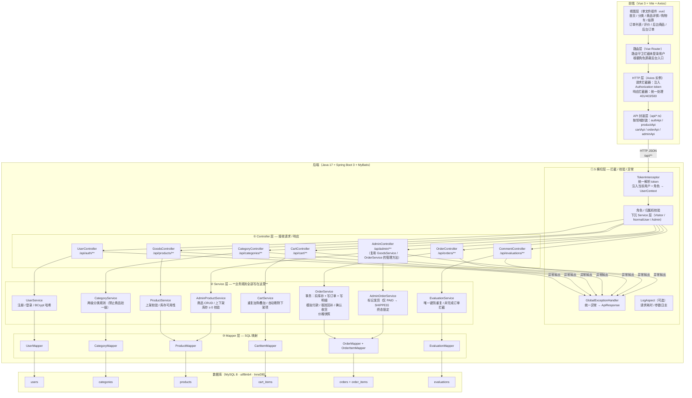
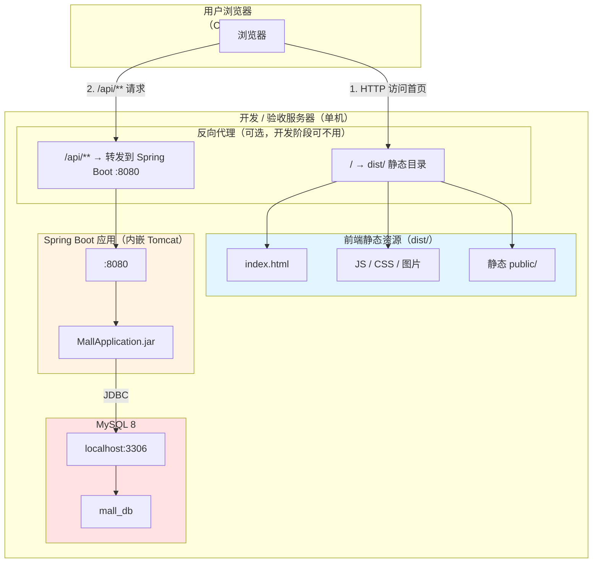

# 文具商城 MVP · 系统架构设计文档

> 版本：v1.0 · 日期：2026-10-29
> 依赖文档：[PRD.md](../01-requirements/PRD.md) · [USER_STORIES.md](../01-requirements/USER_STORIES.md) · [GLOSSARY.md](../01-requirements/GLOSSARY.md)
> **硬性约束**：禁止引入 Redis、MQ、微服务、Docker；业务规则**全部写在 Service 层**

---

## 1. 技术栈总览

### 1.1 前端（Vue 3 + Vite + Axios）

| 类别 | 选型 | 版本 | 用途 |
|------|------|------|------|
| 框架 | **Vue 3** | 3.4+ | 组合式 API (`<script setup>`) + `<script lang="ts">` |
| 构建工具 | **Vite** | 5.x | 开发服务器 + 生产打包 |
| 路由 | **Vue Router** | 4.x | SPA 路由，含路由守卫（登录态判断） |
| HTTP 客户端 | **Axios** | 1.6+ | 请求 / 响应拦截器（统一注入 token、统一错误处理） |
| UI 组件库 | **Element Plus** | 2.5+ | 快速搭建表单 / 表格 / 弹窗（可选，也可手写） |
| 状态管理 | **Pinia** | 2.x | 轻量状态管理（可选，MVP 规模小可不引入） |
| 语言 | **TypeScript** | 5.x | 前后端接口类型对齐（参考 GLOSSARY.md） |

### 1.2 后端（Java 17 + Spring Boot 3 + MyBatis）

| 类别 | 选型 | 版本 | 用途 |
|------|------|------|------|
| 语言 | **Java** | 17（LTS） | 官方强约束版本 |
| 框架 | **Spring Boot** | 3.2+ | 自动配置 + 内嵌 Tomcat |
| Web | **Spring MVC**（内置） | — | Controller 层 REST API |
| ORM | **MyBatis** | 3.5+ | SQL 映射；**不引入 MyBatis-Plus**（作业未指定） |
| 连接池 | **HikariCP**（Spring Boot 默认） | — | 高性能 JDBC 连接池 |
| 密码加密 | **Spring Security Crypto**（BCrypt） | 6.x | 密码哈希 + 盐 |
| 参数校验 | **spring-boot-starter-validation**（Jakarta Validation） | — | `@NotNull` / `@Size` / `@Min` 等 |
| JSON 序列化 | **Jackson**（Spring Boot 默认） | — | 统一响应体序列化 |
| 日志 | **SLF4J + Logback**（Spring Boot 默认） | — | 日志输出 |

### 1.3 数据库（MySQL 8）

| 类别 | 选型 | 版本 | 用途 |
|------|------|------|------|
| DBMS | **MySQL** | 8.0+ | 主数据存储 |
| 字符集 | `utf8mb4` | — | 完整支持中文 + Emoji |
| 引擎 | **InnoDB** | — | 事务支持；行级锁；外键约束 |
| 连接方式 | JDBC（`com.mysql:mysql-connector-j`） | 8.x | MyBatis 通过 JDBC 访问 |

### 1.4 本期明确**不引入**的组件（作业禁止）

| 类别 | 排除项 | 作业理由 |
|------|--------|----------|
| 缓存 | ❌ Redis / Redisson | 作业明确不做，MVP 规模小无必要 |
| 消息队列 | ❌ RabbitMQ / RocketMQ / Kafka | 作业明确不做 |
| 微服务 | ❌ Spring Cloud / Dubbo / Nacos | 单体够用，作业明确不做 |
| 容器化 | ❌ Docker / Docker Compose | 作业明确不做 |
| 持久层增强 | ❌ MyBatis-Plus / JPA / Hibernate | 作业指定 MyBatis，MP 非必需 |
| 安全框架 | ❌ Spring Security / Sa-Token | 自定义简单 JWT 拦截器即可；作业未指定完整框架 |
| 对象存储 | ❌ MinIO / 阿里云 OSS | MVP 图片存本地目录即可 |
| 前端增强 | ❌ Pinia / Zustand / TanStack Query | MVP 规模小，Axios + 局部状态足够 |
| SSR / SSG | ❌ Nuxt / Next.js | SPA 足够 |
| 测试框架（可选） | JUnit 5 + Mockito / Vitest | 作业未强制写单测，作为开发辅助可选 |

---

## 2. 系统分层架构图

### 2.1 全局分层图（Mermaid graph TD）



### 2.2 分层依赖规则（红线）

```
前端          后端 Controller       后端 Service        后端 Mapper          MySQL
──────  ───────────────────────  ──────────────────  ────────────────  ────────
api/*.ts  →  Controller 方法      →  Service 方法      →  Mapper 方法      →  SQL
HTTP 调用      调用 Service           调用 Mapper          执行 SQL
                                    ←——— 业务规则全部在这里 ———←
                                     （Controller 不写 if 判断业务）
```

| 规则 | 说明 |
|------|------|
| ✅ **Controller 层只做参数接收 + 调用 Service + 返回响应** | 不写业务 if-else；收到 `userId` 直接交给 Service，由 Service 校验归属权 |
| ✅ **Service 层是业务规则的唯一归属地** | 库存校验、状态机流转校验、下架拦截、事务 `@Transactional` 注解全在 Service |
| ✅ **Mapper 层只写 SQL 映射** | 不写任何业务逻辑；一个 Mapper 方法 = 一条语义完整的 SQL |
| ✅ **依赖方向自上而下** | Controller → Service → Mapper → DB；**禁止**反向依赖（Service 调 Controller） |
| ✅ **通用异常走 GlobalExceptionHandler** | Controller 不做 try-catch；Service 抛出业务异常 → 全局处理器捕获 → 统一响应 |
| ❌ **禁止** Controller 直接调 Mapper | 必须经过 Service |
| ❌ **禁止** Mapper 调另一个 Mapper | 在 Service 层编排多 Mapper 调用 + 事务 |

### 2.3 后端 Controller → Service → Mapper 代码结构示例

```
com.stationerymall
├── controller
│   ├── UserController.java         ← /api/auth/**
│   ├── CategoryController.java     ← /api/categories/**
│   ├── GoodsController.java        ← /api/products/**
│   ├── CartController.java         ← /api/cart/**
│   ├── OrderController.java        ← /api/orders/**
│   ├── CommentController.java      ← /api/evaluations/**
│   └── AdminController.java        ← /api/admin/**（商品 + 订单管理）
├── service
│   ├── UserService / CategoryService / GoodsService / CartService
│   ├── OrderService.java           ← 事务最密集的 Service
│   ├── OrderItemService / CommentService
│   └── impl/                       ← *ServiceImpl（业务校验、状态机、库存、事务全部在此）
├── mapper                          ← 7 个 Mapper 接口（XML 位于 resources/mybatis/mapper/）
│   ├── UserMapper / CategoryMapper / GoodsMapper / CartItemMapper
│   └── OrderMapper / OrderItemMapper / CommentMapper
├── entity                          ← 7 个 PO（与 database-design.md 表结构一致）
├── dto                             ← 请求 DTO（RegisterDTO、GoodsSaveDTO、OrderCreateDTO…）
├── vo                              ← 响应 VO（PageVO、DetailVO、LoginVO、GoodsVO…）
├── enums                           ← UserRoleEnum / GoodsStatusEnum / OrderStatusEnum / BizCodeEnum
├── handler                         ← 枚举 ↔ TINYINT 的 MyBatis TypeHandler
├── exception                       ← 5 个业务异常
├── util                            ← TokenStore、UserContext、BCryptUtil
├── config                          ← WebMvcConfig、TokenInterceptor、GlobalExceptionHandler
└── StationeryMallApplication.java  ← Spring Boot 启动类（@MapperScan）
```

---

## 3. 部署架构

### 3.1 单机前后端分离部署图



### 3.2 部署要点

| 项 | 开发阶段 | 验收 / 演示阶段 |
|----|----------|------------------|
| 前端运行 | `npm run dev`（Vite Dev Server :5173） | `npm run build` 后用 Vite Preview 或直接 `dist/` 挂 Nginx |
| 后端运行 | Spring Boot `main()` 直接启动（:8080） | `java -jar mall-app.jar`（内嵌 Tomcat） |
| MySQL | Docker / 本地 MySQL，端口 3306 | 本地 MySQL（演示机器上） |
| 跨域 | Vite proxy 或 `CorsConfig` 允许 `http://localhost:5173` | Nginx 同端口反代后无跨域 |
| 图片存储 | `backend/src/main/resources/static/images/` | 同左；或改为 `D:/mall-uploads/images/` 本地路径映射 |
| JVM 参数 | 默认即可 | `-Xms256m -Xmx512m` |

### 3.3 数据库连接配置（application.yml 示例）

```yaml
spring:
  datasource:
    url: jdbc:mysql://localhost:3306/mall_db?useUnicode=true&characterEncoding=utf8mb4&serverTimezone=Asia/Shanghai
    username: root
    password: ${DB_PASSWORD:root}
    driver-class-name: com.mysql.cj.jdbc.Driver
    hikari:
      maximum-pool-size: 10
      minimum-idle: 2
      connection-timeout: 30000

mybatis:
  mapper-locations: classpath:mybatis/mapper/*.xml
  type-aliases-package: com.stationerymall.entity
  configuration:
    map-underscore-to-camel-case: true   # snake_case ↔ camelCase 自动映射
```

---

## 4. 关键业务流程架构说明

### 4.1 用户身份认证会话方案

#### 4.1.1 整体方案

```
┌──────────┐      POST /api/auth/login      ┌─────────────┐
│  前端     │ ─────────────────────────────► │  后端        │
│          │  { username, password }        │ UserController │
└──────────┘                                 └──────┬──────┘
     │                                              │
     │                                              ▼
     │                                         UserService.login()
     │                                         ├─ SELECT * FROM users WHERE username = ?
     │                                         ├─ BCrypt.verify(plain, storedHash)
     │                                         ├─ 校验 role 是否允许登录（禁止 ADMIN 从前台登录）
     │                                         └─ 生成 JWT（HS256）：{ jti, userId, username, role, exp }
     │                                              │
     ◄─────────────────────────────────────────────┘
     │  { token: "eyJhbG..." }
     │
     │  后续请求：Authorization: Bearer <token>
     └───────────────────────────────────────────►
```

#### 4.1.2 Token 规格

| 项 | 值 |
|----|-----|
| 算法 | HS256（HMAC-SHA256） |
| Payload 字段 | `jti`（唯一 ID）、`userId`、`username`、`role`（字符串枚举）、`iat`、`exp` |
| 有效期 | 7 天（604800 秒） |
| 密钥 | `application.yml` 配置的随机 256-bit Secret |
| 存储 | **前端 localStorage**（MVP 简化方案；敏感场景建议 httpOnly Cookie） |

#### 4.1.3 密码哈希存储

```java
// UserService.register() — 注册时
String hashed = passwordEncoder.encode(rawPassword);   // BCrypt，Strength=10

// UserService.login() — 登录校验
boolean ok = passwordEncoder.matches(rawPassword, storedHash);
```

| 项 | 值 |
|----|-----|
| 算法 | BCrypt |
| Strength | 10（建议） |
| 盐 | BCrypt 自动生成随机盐（每次不同） |
| DB 字段 | `users.password VARCHAR(128)` |
| **红线** | **DB 中绝不能出现明文密码**；Spring Boot Actuator / SQL 面板检查为验收项 |

#### 4.1.4 登出使旧会话失效

由于不引入 Redis / 外部存储，登出后的 token 失效采用 **DB 黑名单表** 方案（轻量替代）：

```sql
CREATE TABLE revoked_tokens (
    jti VARCHAR(64) PRIMARY KEY,
    revoked_at DATETIME NOT NULL,
    expires_at DATETIME NOT NULL,
    INDEX idx_expires_at (expires_at)
);
```

```java
// AuthService.logout()
public void logout(String token) {
    JwtPayload payload = jwtUtil.parse(token);
    revokedTokenMapper.insert(payload.jti, LocalDateTime.now(), payload.expiresAt);
}

// AuthInterceptor 每次请求先查黑名单
@Override public boolean preHandle(...) {
    String token = extractToken(request);
    JwtPayload payload = jwtUtil.parse(token);
    if (revokedTokenMapper.existsByJti(payload.jti)) {
        throw new BusinessException(ApiCode.UNAUTHORIZED, "登录态已失效");
    }
    request.setAttribute("currentUserId", payload.userId);
    request.setAttribute("currentUserRole", payload.role);
    return true;
}
```

**历史清理**：可在 Service 启动时或管理端定时清理 `revoked_tokens` 表中 `expires_at < NOW()` 的记录（MVP 手动执行即可，不引入 Spring Scheduling）。

---

### 4.2 下单事务设计

#### 4.2.1 事务流程图

```
Service 层：OrderService.createOrder(userId, CreateOrderDTO)
│
├─ @Transactional(rollbackFor = Exception.class)  ← Spring 声明式事务
│
├─ 1. SELECT cart_items WHERE user_id = #{userId} AND id IN (#{勾选行})
│     └─ 过滤掉关联 product.on_shelf = 0 的项（下架拦截）
│
├─ 2. 校验：每行 quantity <= product.stock（库存校验）
│     └─ 超量 → 抛 BusinessException → 事务回滚 → 返回具体不足商品清单
│
├─ 3. SELECT products ...（快照读出：product_id, name, price）
│
├─ 4. UPDATE products SET stock = stock - #{delta} WHERE id = #{id} AND stock >= #{delta}
│     └─ 影响行数 = 0 → 抛异常 → 回滚（二次校验，防并发超卖）
│
├─ 5. INSERT INTO orders (user_id, status='UNPAID', total_amount, address, ...)
│     total_amount = 服务端循环重算 Σ(product.price × quantity)
│
├─ 6. INSERT INTO order_items (order_id, product_id, product_name, unit_price, quantity, subtotal)
│     其中 product_name 和 unit_price 就是步骤 3 读到的快照值
│
├─ 7. DELETE FROM cart_items WHERE id IN (#{勾选行})   ← 清空已勾选购物车行
│
└─ 8. 事务提交
     ├─ 全部成功 → 事务 commit
     └─ 任意失败 → Spring 自动 rollback（AOP 代理兜底）
```

#### 4.2.2 关键技术点

| 项 | 实现 | 原因 |
|----|------|------|
| 事务声明 | `@Transactional(rollbackFor = Exception.class)` 在 `OrderService.createOrder()` 方法上 | Spring 默认只对 RuntimeException 回滚；显式加 `rollbackFor = Exception.class` 保证 checked exception 也回滚 |
| 并发防超卖 | `UPDATE ... WHERE stock >= delta` + 检查影响行数 | 乐观锁轻量版；避免引入 Redis 分布式锁 |
| 价格快照 | 步骤 3 先 SELECT 商品 → 步骤 6 INSERT 快照字段 | 防止管理员在事务期间改价导致数据不一致 |
| 金额重算 | 后端 `for` 循环累加，**前端传来的 total 字段不采信** | 防金额篡改 |
| 事务边界 | **3 张表操作（products / orders / order_items）+ 1 次 DELETE cart_items** | 全在一个方法里，无远程调用 |

#### 4.2.3 事务失败处理清单

| 失败点 | Spring 行为 | 系统表现 | 用户看到 |
|--------|-------------|----------|----------|
| 任一 SQL 抛异常（库存不足 / 外键违反 / 唯一键冲突） | 自动回滚 | orders / order_items 无数据；products 库存不扣；cart_items 不清 | 结算页停留 + 具体错误提示 |
| 步骤 4 UPDATE 影响行数 = 0（并发超卖） | 抛 BusinessException → 回滚 | 同左 | "商品 X 库存不足" |
| 步骤 5 INSERT orders 失败 | 自动回滚 | 同左 | 通用"下单失败，请稍后重试" |

---

### 4.3 权限控制设计（RBAC）

#### 4.3.1 整体模型

```
用户 ──[拥有]──► 角色
                 │
                 ├── VISITOR      → 未登录，仅浏览
                 ├── NORMAL_USER  → 注册生成，可购物
                 └── ADMIN        → DB 预置，可运营，禁止下单

请求到达 ──► AuthInterceptor（解析 token）──► RoleInterceptor（校验角色）──► Controller
                │                                    │
                ├─ 无 token → 401                   ├─ 角色不符 → 403
                └─ 有 token → 注入 currentUser       └─ 通过 → 继续
```

#### 4.3.2 拦截器注册（WebMvcConfig）

```java
@Configuration
public class WebMvcConfig implements WebMvcConfigurer {

    @Override
    public void addInterceptors(InterceptorRegistry registry) {
        // 拦截所有接口
        registry.addInterceptor(authInterceptor)
            .addPathPatterns("/api/**")
            .excludePathPatterns(
                "/api/auth/register",
                "/api/auth/login",
                "/api/products/**",         // 前台商品浏览无需登录
                "/api/categories/**"
            );

        // 角色校验拦截器（在 Auth 之后）
        registry.addInterceptor(adminRoleInterceptor)
            .addPathPatterns("/api/admin/**");   // 仅 ADMIN 可访问
    }
}
```

#### 4.3.3 方法级角色注解（可选增强）

```java
// 自定义注解
@Target(ElementType.METHOD)
@Retention(RetentionPolicy.RUNTIME)
public @interface RequireRole {
    UserRole[] value();
}

// 在 Controller 方法上使用
@PostMapping("/api/cart/items")
@RequireRole(UserRole.NORMAL_USER)
public ApiResponse<CartItem> addToCart(...) { ... }
```

#### 4.3.4 订单归属权校验（Service 层强制）

```java
// OrderService.getOrderDetail()
public OrderDetailVO getOrderDetail(Long currentUserId, Long orderId) {
    Order order = orderMapper.selectById(orderId);
    if (order == null) throw new BusinessException(NOT_FOUND, "订单不存在");
    if (!order.getUserId().equals(currentUserId)) {
        throw new BusinessException(FORBIDDEN, "无权访问该订单");   // 关键：Service 层再次校验
    }
    // ...
}
```

| 层级 | 做什么 | 不依赖什么 |
|------|--------|-----------|
| 前端 | 隐藏 / 禁用按钮（**仅 UX 友好**，不是安全手段） | 不依赖前端隐藏做安全 |
| AuthInterceptor | 解析 token → 注入 currentUserId + role | — |
| RoleInterceptor / @RequireRole | 角色匹配（拦截 `/api/admin/**` 等） | — |
| **Service 层**（关键） | **业务归属权二次校验**：userId 匹配 / 订单状态机合法转换 | — |
| Mapper | 绝不写安全逻辑 | — |

---

## 5. 风险与约束清单

> 以下约束是**架构层面**的硬红线，不是实现细节，一旦违反就会引发严重业务事故或验收不通过。

### 5.1 数据库层面约束

| 编号 | 约束 | 架构风险 | 落地方式 |
|------|------|----------|----------|
| **DB-01** | 库存 `products.stock` ≥ 0 | 若允许负数 → 超卖事故 | MySQL UNSIGNED INT + Service 层 `stock - delta >= 0` 二次校验 + UPDATE 带 `WHERE stock >= delta` |
| **DB-02** | 订单 5 状态固定（UNPAID/PAID/SHIPPED/COMPLETED/CANCELLED） | 随意扩展 → 状态机逻辑失控 | `order.status` TINYINT + Service 层每次变更做前置校验 + DB CHECK 注释 |
| **DB-03** | COMPLETED / CANCELLED 是终态 | 终态被修改 → 业务闭环断裂 | Service 层拦截 + 任何角色对终态做写操作抛异常 |
| **DB-04** | 事务原子性（扣库存 + 写订单 + 写明细） | 事务中间失败 → 库存丢失 + 孤儿订单 | `@Transactional` + `rollbackFor = Exception.class` + 测试必测事务回滚场景（BDD US04-03） |
| **DB-05** | 价格快照不可变 | 订单明细通过 JOIN 实时算 → 管理员改价导致历史订单错乱 | `order_items.product_name` / `unit_price` 是独立字段（冗余快照），下单事务内一次性写入 |
| **DB-06** | 评价唯一键（order_id, product_id, user_id） | 重复评价刷星 | MySQL `UNIQUE INDEX` + Service 层 catch DuplicateKeyException → 转业务异常 |
| **DB-07** | 下架商品不出现在前台 | 列表 / 分类 / 直链遗漏拦截 → 下架商品仍可被购买 | SQL 统一追加 `WHERE on_shelf = 1`（Mapper XML 层面硬编码）；直链返回明确提示 |
| **DB-08** | 密码不明文存库 | 数据泄露 → 用户密码外泄 | BCrypt 哈希 + 盐；DB 审计验收项 |

### 5.2 业务规则层面约束

| 编号 | 约束 | 架构风险 | 落地方式 |
|------|------|----------|----------|
| **BR-01** | 金额由服务端重算，前端传来的不采信 | 篡改前端金额字段 → 0 元订单 | Controller 接收 DTO 不含 total 字段；Service 循环重算 |
| **BR-02** | 注册只允许产生 NORMAL_USER | 管理员账号泄露到注册入口 → 权限越权 | Controller 层过滤 role 字段；Service 强制 `role = USER` |
| **BR-03** | 管理员禁止下单 | 管理员给自己开折扣订单 | RoleInterceptor 拦截 + Service 层 `if (currentRole == ADMIN) throw` 双重校验 |
| **BR-04** | 取消订单仅限 UNPAID + 库存回补 | 非待支付订单被取消 → 钱货两错 | Service 层 `if (status != UNPAID) throw` + `UPDATE products SET stock = stock + delta` |
| **BR-05** | 标记发货仅限 PAID → SHIPPED | 终态订单被发货 → 订单闭环断裂 | Service 层状态机校验表（Map<合法前置, 合法后置>） |
| **BR-06** | 确认收货仅限 SHIPPED → COMPLETED | 未发货订单被确认收货 → 货不对版 | 同 BR-05 |
| **BR-07** | 评价仅限 COMPLETED 订单 | 未完成订单被评价 → 评价可信度低 | Service 层查订单状态 = COMPLETED 才允许插入 evaluations |

### 5.3 安全层面约束

| 编号 | 约束 | 架构风险 | 落地方式 |
|------|------|----------|----------|
| **SEC-01** | 所有用户输入做 XSS 清洗 | 商品描述 / 评论注入脚本 | 后端 sanitize + 前端 `v-text` 而非 `v-html` |
| **SEC-02** | MyBatis Mapper 只用 `#{}` 预编译参数 | `${}` 拼接 SQL → 注入 | Code Review 红线 |
| **SEC-03** | 响应数据脱敏 | 密码哈希返回前端 → 安全隐患 | 注册/登录返回体只含 token + userId + role |
| **SEC-04** | 敏感接口限速 | 暴力破解 | 登录 IP 每分钟 ≤ 10 次（可选，MVP 可先用简单计数） |

### 5.4 架构层面约束（禁止引入）

| 编号 | 禁止项 | 原因 |
|------|--------|------|
| **A-01** | Redis 缓存 | 作业明确不做；MVP 数据量小，DB 查询足够 |
| **A-02** | 消息队列 | 作业明确不做；单体事务即可保证一致性 |
| **A-03** | 微服务拆分 | 作业明确不做；单体 Spring Boot 足够 |
| **A-04** | Docker 部署 | 作业明确不做；本地 `java -jar` 即可演示 |
| **A-05** | Spring Security / Sa-Token 完整框架 | 作业未指定；自定义简单拦截器满足 MVP 需求 |
| **A-06** | 对象存储（OSS / MinIO） | 作业未指定；本地静态目录够用 |
| **A-07** | MyBatis-Plus / JPA | 作业指定 MyBatis 原生，增强框架非必需 |
| **A-08** | Pinia / Zustand 全局状态 | 作业未指定；Axios + 组件局部状态足够 |
| **A-09** | 定时任务（Spring Scheduling） | 作业未指定定时关单等；如需清理 revoked_tokens 手动执行即可 |

---

*—— END OF ARCHITECTURE ——*
