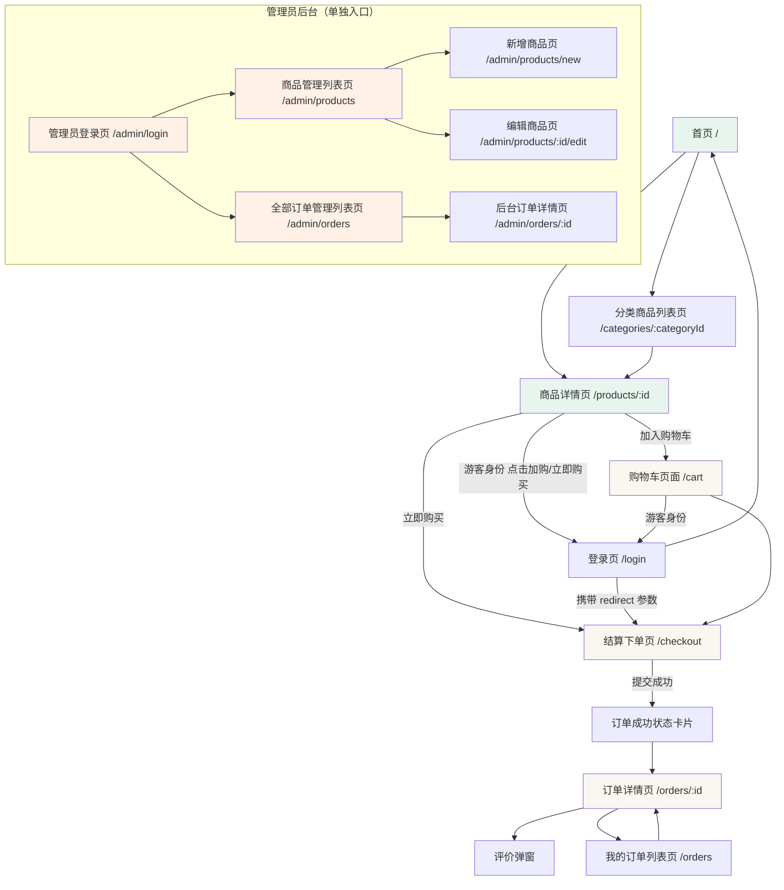

# 文具商城 MVP · UI/UX 设计说明文档

> 版本：v1.0 · 日期：2026-10-29
> 依赖文档：[PRD.md](../01-requirements/PRD.md) · [USER_STORIES.md](../01-requirements/USER_STORIES.md)
> 技术栈：Vue 3 + Vite + Axios 前端（不含后端实现）
> 角色统一命名：Visitor 游客 / NormalUser 普通用户 / Admin 管理员
> **硬边界**：MVP 极简闭环，不引入真实支付、物流、会员、优惠券、评价图片等非目标

---

## 一、产品视觉定位

### 1.1 产品气质

年轻 · 干净 · 可信 · 轻量。面向学生和年轻办公群体的文具购物场景。视觉语言克制、亲和、校园风，拒绝厚重商业后台感和花哨营销噪音。

### 1.2 颜色体系

| 用途 | 色值 | HEX | 使用位置 |
|------|------|-----|----------|
| **品牌主色** | 薄荷绿 | `#2F7A57` | 主按钮、成功状态文字、关键操作、链接、聚焦描边 |
| **主色悬停** | 深薄荷绿 | `#266248` | 主按钮 hover 态 |
| **主色按下** | 暗薄荷绿 | `#1E4D38` | 主按钮 active 态 |
| **页面底色** | 浅米白 | `#FAF7F0` | 全局背景（非纯白，降低视觉刺眼） |
| **卡片底色** | 纯白 | `#FFFFFF` | 所有卡片、弹窗、表单面板 |
| **正文色** | 深灰 | `#2C2C2C` | 页面标题、正文、标签 |
| **次要文字** | 中灰 | `#6B6B6B` | 辅助说明、时间戳、描述文字 |
| **占位符** | 浅灰 | `#B5B5B5` | 输入框 placeholder |
| **边框分割** | 极浅灰 | `#EFECE6` | 卡片分割线、输入框描边 |
| **成功辅助色** | 浅绿 | `#E8F5EE` | 库存充足标签、成功 Toast 背景、已完成状态标签 |
| **警告辅助色** | 浅橙 | `#FFF1E6` | 库存紧张标签、已取消状态标签 |
| **错误辅助色** | 浅红 | `#FDECEA` | 错误提示背景、失败 Toast、下架商品标签 |
| **信息提示** | 浅蓝 | `#E6F0FA` | 信息 Toast、Loading 小提示背景 |
| **按钮禁用底** | 极浅灰 | `#F2F2F2` | 禁用按钮背景 |
| **按钮禁用字** | 中灰 | `#9E9E9E` | 禁用按钮文字 |

### 1.3 字体层级

| 层级 | 字号 | 字重 | 场景 |
|------|------|------|------|
| 页面标题 | 20-24px | SemiBold（600） | 各页面顶部标题栏，如"我的订单"、"购物车" |
| 模块标题 | 16-18px | Medium（500） | 卡片内分区标题，如结算页"商品清单" |
| 正文 | 14px | Regular（400） | 商品名称、订单号、表单 label、操作按钮内文字 |
| 辅助说明 | 12px | Regular（400） | 描述文字、时间戳、小标签、库存提示 |
| 价格主标 | 20-24px | Bold（700） | 商品卡片价格、结算页总金额 |
| 弹窗标题 | 18px | Medium（500） | Modal 弹窗顶部 |

### 1.4 圆角与阴影

| 元素 | 圆角 | 阴影规格 |
|------|------|----------|
| 卡片 | 12px | `0 2px 8px rgba(44,44,44,0.06)` — 轻柔层级 |
| 主按钮 | 8px | hover 时加强 → `0 4px 12px rgba(47,122,87,0.25)` |
| 次按钮 | 8px | 无阴影 |
| 输入框 | 8px | 无阴影（仅边框） |
| Toast | 8px | `0 4px 16px rgba(0,0,0,0.08)` |
| Modal 弹窗 | 16px | `0 8px 32px rgba(0,0,0,0.12)` |
| 标签 / 徽章 | 6px | 无阴影 |

### 1.5 留白节奏

| 层级 | 间距 | 场景 |
|------|------|------|
| 页面安全边距 | 16px | 页面左右内边距（桌面端 max-width 1200px 居中） |
| 卡片内部 padding | 16px | 所有卡片内容区内边距 |
| 卡片之间 | 12px | 同页面内卡片之间的垂直/水平间距 |
| 模块之间 | 24px | 页面顶部导航与内容、结算页分区之间 |
| 表单 label ↔ 输入框 | 8px | 垂直布局表单 |
| 输入框 ↔ 输入框 | 12px | 同表单内连续字段 |
| 按钮组间距 | 8px | 同操作区内多按钮的水平距离 |

---

## 二、用户体验总原则

| # | 原则 | 实现 |
|---|------|------|
| 1 | **首屏优先展示商品，减少跳转** | 首页直接放分类导购区 + 商品卡片；不强制"先选分类再看商品" |
| 2 | **所有操作必须有明确反馈** | 每个关键操作（加购、下单、取消、确认收货、评价）都有 Toast 或弹窗反馈；覆盖五种页面状态 |
| 3 | **按钮状态必须表达清楚** | 每个按钮都有：默认态 / hover 态 / 禁用态 / 加载态 / 成功态 |
| 4 | **业务规则以后端为准** | 前端只做 UX 友好提示（禁用按钮、置灰、标签），**安全规则依赖后端拒绝** |
| 5 | **路径清晰，不让用户迷路** | 购物车 → 结算 → 下单 → 订单 → 评价 形成一条线性闭环，每步有明确"下一步"引导 |
| 6 | **下架商品必须有清晰的降级体验** | 已下架商品详情页不返回 404，显示"已下架"标签 + 置灰操作区，保留图片和描述方便用户了解 |
| 7 | **管理员禁止下单** | 管理员进入商品详情页时加购/立即购买按钮隐藏或显示"管理员无法购买"提示 |

---

## 三、页面信息架构

### 3.1 前台页面清单（Visitor / NormalUser）

| 路由路径 | 页面名称 | 角色 | 核心组件 |
|----------|----------|------|----------|
| `/` | 首页 | Visitor / NormalUser | 导航栏 + 分类导购区 + 商品卡片列表 + 推荐商品 |
| `/categories/:categoryId` | 分类商品列表页 | Visitor / NormalUser | 顶部分类 Tab + 商品卡片网格 |
| `/products/:id` | 商品详情页 | Visitor / NormalUser | 图片 + 信息区 + 操作区 + 评价列表 |
| `/login` | 登录页 | Visitor | 卡片表单（用户名 + 密码） |
| `/register` | 注册页 | Visitor | 卡片表单（用户名 + 密码 + 确认密码） |
| `/cart` | 购物车页面 | NormalUser | 购物车项列表 + 结算栏 |
| `/checkout` | 结算下单页 | NormalUser | 地址输入 + 商品清单 + 提交按钮 |
| `/orders` | 我的订单列表页 | NormalUser | 状态 Tab + 订单卡片 |
| `/orders/:id` | 订单详情页 | NormalUser | 状态进度 + 商品明细 + 操作按钮 + 评价入口 |
| `/forbidden` | 无权限页 | 所有 | 简洁提示 + 返回首页按钮 |

### 3.2 后台页面清单（Admin）

| 路由路径 | 页面名称 | 角色 | 核心组件 |
|----------|----------|------|----------|
| `/admin/login` | 管理员登录页 | Admin | 卡片表单（管理员账号 + 密码） |
| `/admin/products` | 商品管理列表页 | Admin | 顶部筛选 + 商品表格 |
| `/admin/products/new` | 新增商品页 | Admin | 表单（两级分类 + 信息） |
| `/admin/products/:id/edit` | 编辑商品页 | Admin | 同新增，字段预填 |
| `/admin/orders` | 全部订单管理列表页 | Admin | 顶部筛选 + 订单表格 |
| `/admin/orders/:id` | 后台订单详情页 | Admin | 完整订单信息 + 标记发货按钮 |

---

## 四、关键页面详细设计要求

### 4.1 首页设计要求

**顶部导航栏（固定在顶部，浅色背景 #FAF7F0）：**
- 左侧：品牌 Logo + "文具商城"文字标识
- 中间：一级分类快捷入口（最多显示 5 个，超出用"更多"下拉）
- 右侧：未登录时显示"登录"、"注册"按钮；已登录显示用户头像（默认头像）+ 下拉菜单（"我的订单"、"登出"）
- 导航栏高度 56px；阴影 `0 1px 4px rgba(0,0,0,0.04)`

**分类导购区（首屏上半部分）：**
- 以胶囊标签形式展示所有一级分类，选中态为主色背景 + 白色文字，未选中为浅米白底 + 深灰文字
- 胶囊水平排列，超出可横滑；点击后下方商品列表联动刷新（不跳转页面，局部刷新提升流畅度）
- 胶囊高度 36px，圆角 18px，内边距 0 16px

**商品卡片区（首屏下半部分）：**
- 响应式网格布局：桌面 3 列，平板 2 列，手机 1 列
- 每张卡片圆角 12px，白底 + 轻阴影
- 卡片内容区：上 60% 为商品图片（background 居中 cover），下 40% 为信息区
- 信息区展示：商品名称（最多 2 行，溢出省略）、价格（主色加粗）、库存状态标签（"有货"/"库存紧张"/"已下架"）
- **Hover 微交互**：鼠标悬停时卡片轻微上浮 2px、阴影加深、"加入购物车"小按钮从隐藏变为显示
- 空数据时：页面居中显示轻量插画（如空货架图标）+ "暂无商品" + 返回首页按钮

### 4.2 商品详情页设计要求

**页面结构（从上到下）：**

1. **面包屑**：首页 > 二级分类名 > 商品名（点击可返回）
2. **图片区**：商品大图（max-width 100%，圆角 12px，占位灰色）
3. **信息区**：
   - 商品名称：页面标题级别（20-24px, SemiBold）
   - 价格：醒目大字（24px, Bold, 主色）
   - 库存状态标签：右侧内联，三种状态对应三种标签颜色（浅绿/浅橙/浅红背景）
   - 商品描述：纯文本展示，14px，多行，行高 1.6
   - 评价摘要：商品平均评分 + 评价数量入口，点击跳转到下方评价列表
4. **固定底部操作栏**（sticky 或页面下方）：
   - 左侧"加入购物车"按钮（次按钮样式，白色 + 主色边框）
   - 右侧"立即购买"按钮（主按钮样式，主色背景）
   - 两个按钮宽度 48%，圆角 8px，高度 44px
5. **评价列表区**（页面下方，仅 COMPLETED 订单已评价时才有）：
   - 每条评价：星级展示（主色星）+ 用户名 + 时间 + 文字评论
   - 分页加载

**已下架商品降级体验：**
- 图片和描述区域保留（置灰滤镜）
- 操作区整体置灰，按钮禁用且显示"该商品已下架"提示
- 库存标签固定为"已下架"（浅红背景）
- 不显示评价摘要入口

**管理员访问详情页：**
- 按钮隐藏或置灰，显示提示"管理员无法购买"

### 4.3 购物车页面设计要求

**顶部操作栏：**
- 左侧"购物车"标题 + 商品数量角标（红色小徽章）
- 右侧"清空购物车"文字按钮（浅红文字），点击需二次确认

**购物车项列表（垂直堆叠）：**
- 每项为横向卡片：左侧勾选框（默认全选） + 中间商品信息（缩略图 80×80 + 商品名称 + 单价） + 右侧数量步进器 + 小计金额
- 数量步进器：减号按钮 | 数字输入框（居中显示） | 加号按钮；最小值 1；超过库存时数字变红并显示轻量 Toast "库存仅剩 N 件"
- 下架商品标签：商品卡片右上角固定位置显示浅红"已下架"标签；结算时自动剔除并显示轻量 Toast
- 库存不足标签：浅橙"库存紧张，仅剩 N 件"

**底部固定结算栏（sticky bottom，背景纯白 + 顶部阴影）：**
- 左侧：已勾选数量 × "件商品"
- 中间："合计" + 金额（主色加粗）
- 右侧：主按钮"去结算"（仅 NormalUser 可用；未登录则显示"请先登录"按钮）
- 结算按钮在无勾选商品时禁用

**空购物车状态：**
- 居中插画（空购物袋） + "购物车空空如也" + "去逛逛"主按钮（跳转首页）

### 4.4 结算下单页设计要求

**顶部标题栏：** "确认订单" + 返回箭头

**地址输入区（卡片，padding 16px）：**
- label："收货地址 *" + 红色星号
- textarea 输入框（4 行，placeholder："请填写收货人姓名、电话、详细地址"）
- 下方浅灰色 12px 说明："MVP 仅支持文本地址，不做地址簿管理"

**商品清单区（卡片）：**
- 标题"商品清单" + 数量角标
- 每行：缩略图 + 商品名称 + 单价 × 数量 = 小计（右对齐）
- 底部分割线 + 汇总："商品金额合计" + 金额（服务端返回值）
- 注意：如果进入结算时购物车下架项已被自动剔除，此处实际展示的就是剔除后的有效商品

**金额汇总区（卡片）：**
- 商品小计（如果不含运费）
- 合计金额（主色，大字号）

**提交按钮区（卡片底部，sticky bottom 或页面底部）：**
- 主按钮，全宽，文案"提交订单并模拟付款"
- 点击后进入 **Loading 态**（按钮 disabled + 内部 spinner + 防重复点击）
- 成功后弹窗或跳转到订单成功页

**下单成功状态卡片：**
- 居中成功图标（绿色对勾）+ "订单创建成功" + 订单号 + "去订单详情"主按钮

**校验失败反馈：**
- 地址为空 → label 下方红色提示"请填写收货地址"
- 商品无效 → 页面顶部红色 Alert + "以下商品无效：XXX 已下架 / XXX 库存不足"

### 4.5 我的订单列表页设计要求

**顶部状态 Tab（横向可横滑）：**
- Tab 项：全部 / 待支付 / 已支付 / 已发货 / 已完成 / 已取消
- 当前选中 Tab 下方有 2px 主色下划线，文字加粗主色；未选中为深灰常规

**订单卡片列表（垂直堆叠）：**
- 每张卡片圆角 12px，内边距 16px
- 卡片顶部：订单号（次要灰）+ 右侧订单状态徽章（5 种状态对应不同颜色）
- 卡片中部：商品缩略图（80×80，超过 3 件显示"+N"叠层）+ 主商品名 + "共 N 件"
- 卡片底部（固定样式，按状态变化）：
  - **UNPAID**（待支付）：左侧总金额 + 右侧两按钮 "取消订单"（危险按钮）+ "模拟付款"（主按钮）
  - **PAID**（已支付）：左侧总金额 + 右侧 "等待发货…" 灰色文字（无操作按钮）
  - **SHIPPED**（已发货）：左侧总金额 + 右侧 "确认收货" 主按钮
  - **COMPLETED**（已完成）：左侧总金额 + 右侧 "评价" 次按钮 + "查看详情" 文字按钮
  - **CANCELLED**（已取消）：左侧总金额 + 右侧灰色"已取消"标签（终态，无操作按钮）

**终态视觉标记：** COMPLETED 和 CANCELLED 卡片右上角显示浅灰"终态"角标

**订单详情页（从卡片点击进入）：**
- 状态进度条（横向 5 步：待支付 → 已支付 → 已发货 → 已完成 / 已取消；当前节点主色填充，已过节点浅绿，未过节点浅灰）
- 商品明细区（同结算页商品清单样式）
- 时间线：下单时间 → 付款时间 → 发货时间 → 完成时间 / 取消时间（按实际存在的节点显示）
- 底部操作区（同列表卡片的底部按钮，按当前状态动态变化）
- 评价入口：已完成订单中的每件商品右侧显示"评价"按钮（仅商品级，不是订单级）

### 4.6 后台管理页面设计要求

**整体风格：** 简洁中性风，左侧菜单 220px（白色），右侧内容区 #FAF7F0 底色；不走花哨前台风格

**后台布局骨架：**
```
┌──────────────────────────────────────────────┐
│  顶部 56px：Logo + "文具商城管理后台" + admin 头像 + 登出 │
├──────────┬───────────────────────────────────┤
│          │                                   │
│ 左侧菜单  │       右侧内容区（#FAF7F0）         │
│          │                                   │
│ 商品管理  │                                   │
│ 订单管理  │                                   │
│          │                                   │
└──────────┴───────────────────────────────────┘
```

**左侧菜单（白底 + 主色选中）：**
- "商品管理" → 二级菜单："商品列表" + "新增商品"
- "订单管理" → 二级菜单："订单列表"
- 当前选中项：主色背景 + 白色文字 + 左侧 3px 主色竖条

**商品管理列表页：**
- 顶部筛选栏：状态下拉（上架/下架/全部）+ 二级分类下拉 + 商品名搜索框 + "查询"按钮 + "新增商品"主按钮
- 表格视图（简洁黑白灰风格，无卡片阴影）：商品名 / 分类 / 价格 / 库存 / 状态徽章 / 操作（编辑、上架/下架切换）
- 上架/下架切换用 Toggle Switch 组件，操作后即时 Toast 反馈"已上架"/"已下架"；切换操作需二次确认 Modal
- 库存为 0 的行库存列用浅橙底色

**新增/编辑商品页：**
- 表单卡片：两级分类下拉（**一级分类先选 → 二级分类联动**，强制选二级）、商品名、价格（数字输入框）、库存（整数输入框）、描述（多行文本）、图片 URL（输入框）、上架状态 Toggle
- 底部"保存"主按钮 + "取消"次按钮

**全部订单管理列表页：**
- 顶部筛选栏：状态下拉（待支付/已支付/已发货/已完成/已取消/全部）+ 用户名输入 + "查询"按钮
- 表格视图：订单号 / 用户名 / 金额 / 商品汇总 / 状态徽章 / 创建时间 / 操作（查看详情、标记发货）
- **标记发货**按钮仅在状态为"已支付"的行显示；点击后二次确认 Modal "确认将该订单标记为已发货？此操作不可撤销"

**后台订单详情页：**
- 顶部订单号 + 状态徽章
- 左列：收货地址、用户信息、创建时间、状态流转时间线
- 右列：商品明细表格（商品名 / 单价快照 / 数量 / 小计）
- 底部：标记发货按钮（仅 PAID 状态可点击；其他状态下显示灰色不可点击）

---

## 五、组件与状态规范

### 5.1 按钮组件

| 类型 | 正常态 | Hover 态 | 禁用态 | 加载态 |
|------|--------|----------|--------|--------|
| **主按钮** | 主色背景 #2F7A57 / 白色文字 / 8px 圆角 | 深主色 #266248 / 轻微阴影 | 浅灰底 #F2F2F2 / 中灰字 #9E9E9E / 无点击事件 | 保留主色 / 内部 spinner / 文字改为"处理中…" / disabled |
| **次按钮** | 白底 / 主色边框 / 主色文字 | 浅主色背景 #E8F5EE | 同主按钮禁用 | 同主按钮加载态 |
| **危险按钮** | 浅红底 #FDECEA / 红色文字 | 浅红加深 / 红色加深 | 同主按钮禁用 | 同主按钮加载态 |
| **文字按钮** | 无边框 / 主色文字 | 浅主色背景 | 浅灰字 / 无点击事件 | — |

所有按钮：高度 44px / 最小宽度 88px / 文字 14px Medium / 加载中图标在文字左侧（8px gap）

### 5.2 商品卡片组件

| 状态 | 视觉表现 | 操作按钮 |
|------|----------|----------|
| 正常上架 | 白底 + 轻阴影 + 商品图片 + 主色价格 | Hover 时显示"加入购物车"小按钮 |
| 库存紧张 | 正常上架样式 + 库存标签浅橙底 "库存紧张，仅剩 N 件" | 正常 |
| 库存为 0 | 正常上架样式 + 库存标签浅橙底 "暂时缺货" | 按钮禁用，显示"暂时缺货" |
| 已下架 | **整体 opacity 0.6** + 浅红"已下架"角标 + 按钮隐藏 | 无 |

### 5.3 表单组件

| 元素 | 样式 | 交互 |
|------|------|------|
| 输入框 | 白底 / 1px 浅灰边框 #EFECE6 / 8px 圆角 / height 40px / padding 0 12px | 聚焦时边框变主色 #2F7A57（2px） |
| textarea | 同输入框 / min-height 120px | 聚焦描边同输入框 |
| label | 14px Medium / 深灰 / 必填项后加红色 `*` | — |
| 错误提示 | 12px / 红色 / label 下方 / 与输入框 4px 间距 | 聚焦时自动隐藏 |
| Select 下拉 | 同输入框 / 展开时主色描边 | — |
| 数字输入框 | 额外限制：min/max、非法字符拦截（仅数字和小数点）、实时校验 | — |

### 5.4 反馈组件

| 组件 | 类型 | 样式 | 出现时机 |
|------|------|------|----------|
| **Toast** | 成功 | 浅绿底 + 绿色对勾图标 + 绿色文字 + 右上弹窗 + 2.5s 自动消失 | 加购成功、登录成功、标记发货成功 |
| | 失败 | 浅红底 + 红色叉号图标 + 红色文字 + 右上弹窗 + 不自动消失（手动关闭） | 库存不足、下架商品加购、状态越权 |
| | 信息 | 浅蓝底 + 蓝色图标 + 蓝色文字 + 2.5s 自动消失 | 结算前自动剔除下架商品、登出成功 |
| **Modal 弹窗** | 确认类 | 16px 圆角 + 白底 + 主色标题 + 正文 + 底部"取消"次按钮 + "确认"危险按钮 | 取消订单、标记发货、清空购物车 |
| | 表单类 | 同上 + 内嵌表单区 | 管理员新增商品（也可以独立页面实现） |
| **Loading** | 全局遮罩 | 半透明黑遮罩 + 居中大 spinner | 提交订单、后台查询慢接口 |
| | 局部 | 卡片内居中小 spinner | 列表加载、详情加载 |
| **骨架屏** | 商品卡片 | 浅灰占位块（图片区 + 文字条） + 左右 shimmer 动画 | 商品列表首次加载 |
| **Empty 空状态** | 统一 | 居中插画（SVG） + 标题（16px 中灰） + 说明（12px 浅灰） + 返回操作按钮 | 购物车空、订单列表空、评价空 |
| **无权限页** | 统一 | 居中提示"无权限访问该页面" + 返回首页按钮 + 403 大字（装饰性） | Admin 路径被 NormalUser 访问、他人订单号被访问 |

---

## 六、页面状态反馈规范（五种状态 · 每页面必须覆盖）

| 状态 | 视觉 | 触发场景 | 覆盖范围 |
|------|------|----------|----------|
| **1. 加载中** | 骨架屏（商品列表） / 局部 spinner（详情、购物车、订单） / 全局遮罩 spinner（下单提交） | 页面打开首次请求、API 调用、按钮提交 | 所有依赖 API 的页面 |
| **2. 空数据** | Empty 空状态组件（轻量插画 + 说明 + 返回按钮） | 购物车空、订单列表空、商品分类下无商品、评价列表空 | 购物车 / 订单列表 / 商品详情评价区 |
| **3. 成功** | Toast 绿色提示 + 主按钮 loading 态结束恢复正常 / 订单成功状态卡片 | 加购、登录、下单、标记发货、确认收货、评价 | 所有写操作 |
| **4. 失败** | Toast 红色提示（显示后端返回的 message）+ 按钮恢复可点击 | 库存不足、下架商品加购、状态越权、网络错误 | 所有写操作；列表请求失败显示 Retry 按钮 |
| **5. 无权限** | 无权限页（居中提示 + 返回首页按钮） + 后端返回 403 | NormalUser 访问 `/admin/**`、访问他人订单号 | 全局路由守卫拦截 + API 403 二次拦截 |

---

## 七、关键交互规则

| # | 交互 | 前端行为 | 后端校验（前端不替代） |
|---|------|----------|------------------------|
| 1 | **游客点击加购 / 结算** | 跳转登录页，URL 携带 `?redirect=/cart` | — |
| 2 | **加入购物车** | Toast 绿色提示"已加入购物车"，不自动跳购物车 | `on_shelf=1` + `stock >= qty`；重复加购自动叠加 |
| 3 | **结算前自动剔除下架商品** | 进入结算页时，被剔除的下架商品下方轻量 Toast 提示"已移除 X 件已下架商品" | Service 层先过滤 `cart_items JOIN products WHERE on_shelf=1` |
| 4 | **下单金额前后端不一致** | 提交后以后端返回金额为准，订单详情展示服务端算的金额 | **服务端重算 total_amount**，前端传值不采信 |
| 5 | **取消订单（UNPAID → CANCELLED）** | 按钮点击 → 二次确认 Modal → "确定取消该订单？取消后库存将回补" → Toast 绿色提示"订单已取消" | 校验 status=UNPAID → UPDATE status='CANCELLED' + 库存回补 |
| 6 | **标记发货（PAID → SHIPPED）** | 按钮点击 → 二次确认 Modal → Toast 绿色提示"已标记发货" | 校验 status=PAID（非 PAID 按钮禁用 + Toast "当前状态不可发货"） |
| 7 | **确认收货（SHIPPED → COMPLETED）** | 按钮点击 → Toast 绿色提示"已确认收货" | 校验 status=SHIPPED（非 SHIPPED 按钮禁用 + Toast "订单尚未发货"） |
| 8 | **评价（COMPLETED 订单商品）** | 点击"评价"按钮 → 弹窗（星级 + 评论输入）→ 提交后 Toast "评价成功" | 校验 order.status=COMPLETED + 唯一键防重复；后端拦截后 Toast "您已评价过该商品" |
| 9 | **下架商品被购买** | 商品卡片置灰禁用按钮 / 详情页显示"已下架" | Service 层 `on_shelf=1` 校验 + SQL 硬编码 `WHERE on_shelf=1` |
| 10 | **管理员禁止下单** | 管理员进入详情页时加购按钮隐藏 / 显示提示 | Service 层 `role=ADMIN` → 403 |
| 11 | **越权访问后台** | 路由守卫拦截 → 显示无权限页 | Controller / Service 层 → 403 |
| 12 | **越权访问他人订单号** | 路由守卫不拦截（同域路径），API 返回 403 → Toast "无权访问该订单" + 跳转订单列表 | Service 层 `WHERE id=? AND user_id=?` → 查不到视为无权限 |

---

## 八、页面跳转流程（Mermaid graph TD）



---

## 九、MVP 设计约束（明确排除项）

| 类 | 不做 |
|----|------|
| **动效** | 不做复杂过渡动画、3D 展示、Parallax、无限滚动（分页即可） |
| **促销** | 不做优惠券、秒杀、拼团、满减、会员价、积分抵扣 |
| **支付物流** | 模拟付款按钮即可（不接微信/支付宝）；不做物流跟踪、快递单号、自动发货 |
| **会员** | 不做注册手机号、会员等级、积分、优惠券中心 |
| **商品** | 单图单规格，不做多图轮播、不做 SKU 选择器、不做图片放大镜 |
| **评价** | 纯文字 + 星级，不做图片、追评、点赞、敏感词过滤 |
| **地址** | 单行 textarea 文本输入，不做地区选择器、地址簿、默认地址 |
| **后台** | 不做数据看板、图表大屏、报表导出、批量操作、定时任务 |
| **无障碍** | MVP 不做 ARIA label / 屏幕阅读器 / 键盘导航专项优化（可作为后续迭代） |
| **国际化** | MVP 不做多语言切换 |
| **移动端** | 响应式适配基础保证（CSS Grid / Flex），但不做独立 App 设计 |

---

## 十、设计输出清单

前端开发必须基于本文档产出以下可落地实现：

| # | 输出类别 | 具体产出 |
|---|----------|----------|
| 1 | **视觉规范** | 颜色（CSS Variables）、字体层级、圆角、阴影、间距的统一变量文件（如 `variables.scss` / `tokens.css`） |
| 2 | **页面级 UI** | 首页、分类列表、商品详情、登录注册、购物车、结算下单、订单列表、订单详情、管理员登录、商品管理列表、新增编辑商品、订单管理列表、后台订单详情（共 13 个页面组件） |
| 3 | **组件级状态** | 按钮（主/次/危险/文字 × 5 状态）、商品卡片（4 状态）、表单（输入框/textarea/下拉/数字框 × 错误态）、Toast（3 类型）、Modal（2 类型）、Loading（2 类型）、Empty（1 统一组件）、无权限页（1 组件） |
| 4 | **交互闭环** | 加购、结算、下单、取消订单、标记发货、确认收货、评价（7 个完整交互路径，每步有 Toast + 按钮状态变化 + 页面跳转） |
| 5 | **五种页面状态覆盖** | 加载中（骨架屏/局部 spinner）、空数据（Empty 组件）、成功（Toast + 按钮恢复）、失败（红色 Toast + Retry）、无权限（Forbidden 页） |

---

*—— END OF UI/UX DESIGN ——*
